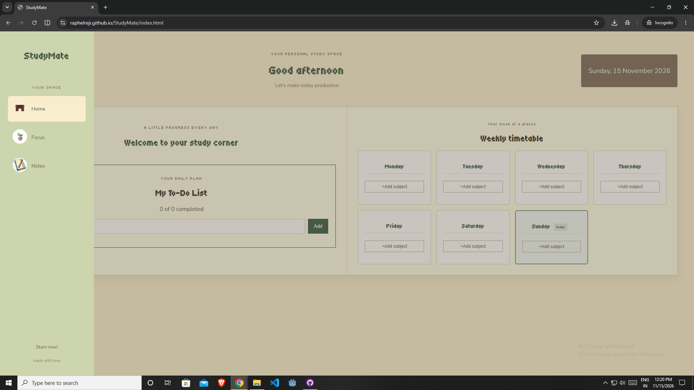
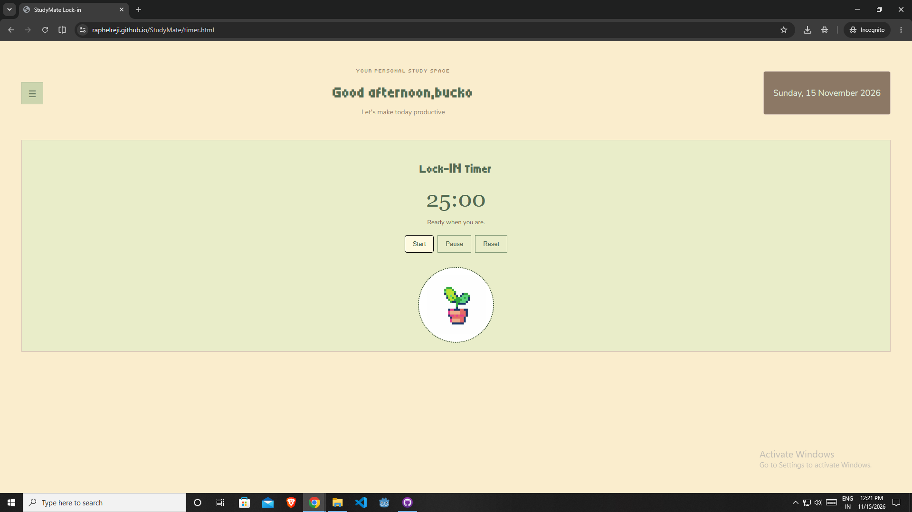
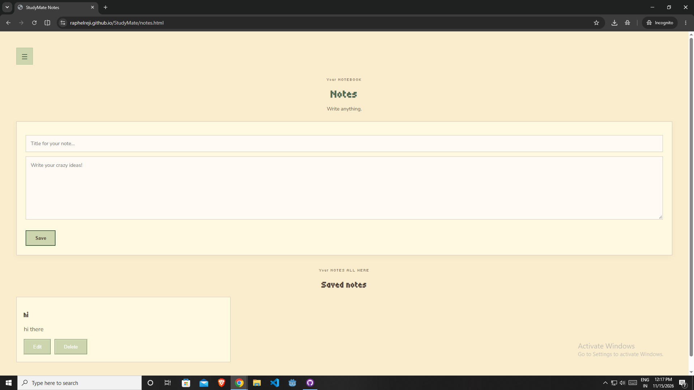

# StudyMate

StudyMate is a little project I made to bring some useful study tools together in one place and help students stay focused and organised.

## Links

- [Live Demo](https://raphelreji.github.io/StudyMate/)

## Screenshots







## Features

- **Dashboard:** Access the different sections of StudyMate.
- **Focus Timer:** A  timer to help students focus.
- **Notes:** Create and organise study notes.
- **To-Do List:** Add and manage daily activities.
- **Paper Theme:** A simple, clean and paper-inspired design.

## Built With

- HTML
- CSS
- JavaScript

## Getting Started

You can run StudyMate locally on your computer.

### Requirements

- A computer
- A web browser
- Visual Studio Code (recommended or use any other)

### Installation

1. Clone the repository:

   ```bash
   git clone https://github.com/RaphelReji/StudyMate.git
   ```

2. Open the downloaded project folder in Visual Studio Code.

3. Open `index.html` in your browser or use the Live Server extension.

That's it! 

## How I Made It

I made StudyMate inspired by the study buddy web applications I looked up on GitHub. I also looked at a YouTube tutorial to understand the structure and working of the To-Do List.

I wanted to make my own website that helps students focus and organise their activities. I learned so many things while building it, especially JavaScript Local Storage. I'm really proud of it!

## Design

I used a **paper-inspired theme** with a simple and clean layout.

**Colour palette:** [Coolors](https://coolors.co/cb997e-ddbea9-ffe8d6-b7b7a4-a5a58d-6b705c)

## Credits

- [Coolors](https://coolors.co/) – Colour palette.
- [Pixabay](https://pixabay.com/) – Photos used in the website.
- [Google Fonts](https://fonts.google.com/) – Fonts used in the project.
- YouTube – To-Do List tutorial for understanding its structure and working.

## License

This project is licensed under the MIT License. See the [LICENSE](LICENSE) file for details.
